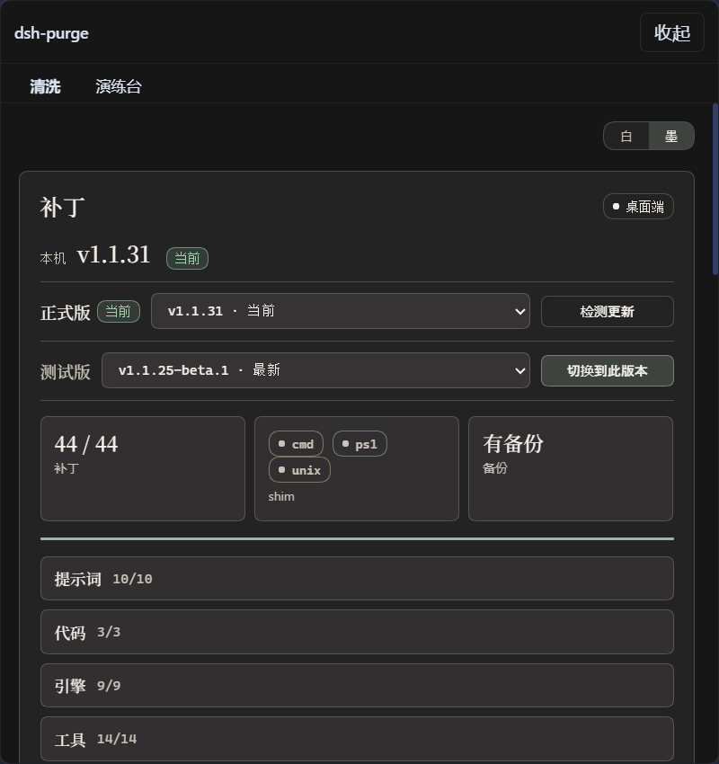
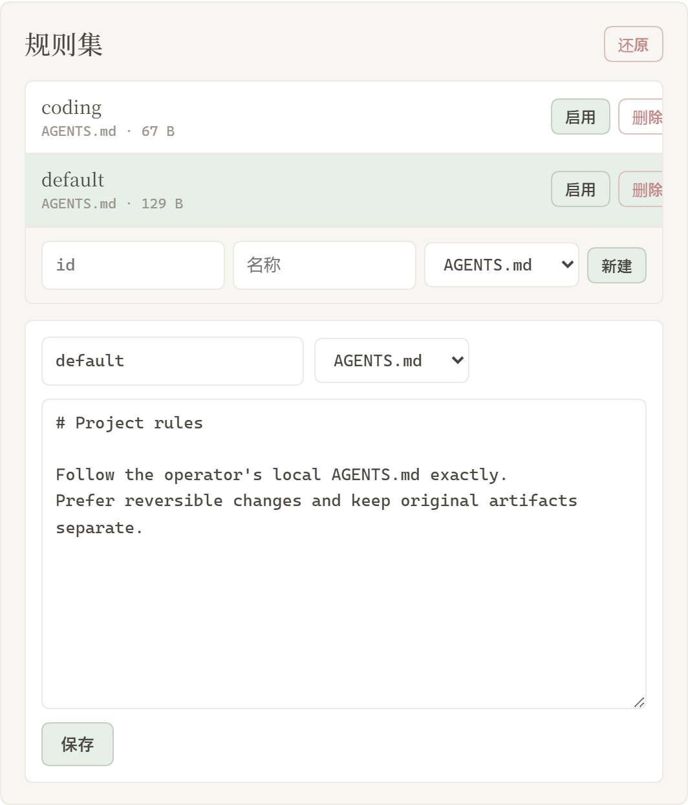
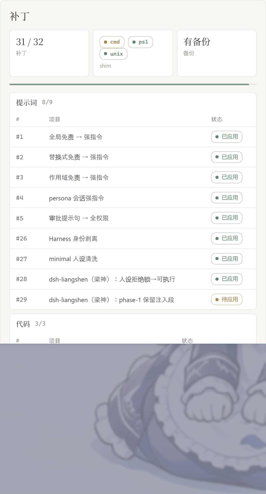
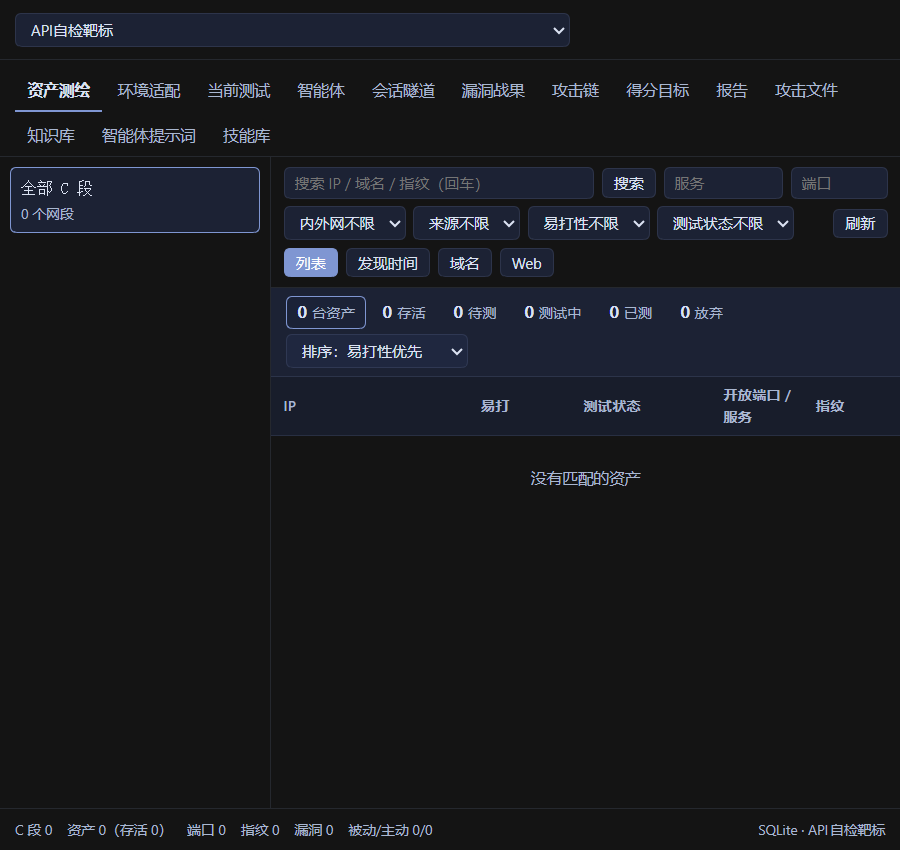

# dsh-purge-022 1.2.1 — DeepSeek Harness 0.2.2 适配分支

[](https://github.com/devin667/dsh-purge-022)
[](https://github.com/devin667/dsh-purge-022/releases/tag/v1.2.1)
[](docs/COMPAT-0.2.2.md)
[](LICENSE)
[](https://github.com/evan545295555-hash/Evans-repo)

[中文](#中文) · [English](#english) · [变更日志](docs/CHANGELOG.md) · [适配说明](docs/COMPAT-0.2.2.md) · [1.2.1 发行说明](RELEASE-NOTES-1.2.1.md)


---

## 中文

`dsh-purge 1.1.71` 的一个分支：把补丁表对齐到 **DeepSeek Harness 0.2.2 系列**，并修掉几处会让「补丁写了但不生效」的链路缺陷。

功能、配置项、展示分组、面板与上游一致。

### 支持哪些宿主

| 宿主 | 推荐版本 |
|---|---|
| **0.2.2-rc.5** | **本版（1.2.1）** |
| 0.2.2-rc.3 / rc.1 | 1.2.1（向后兼容） |
| 0.2.1 系列 | [1.1.71-rc2.1](https://github.com/evan545295555-hash/Evans-repo) |

补丁层用「只追加、不替换」的兼容策略：新锚点追加到已有 `replacements` 末尾，老宿主先命中老锚点、新锚点静默跳过，所以**同一份包在几个 rc 上行为一致**。

### 1.2.1 修的是什么：让「已写入」真的变成「已生效」

官方桌面把宿主装在 `resources/app.asar` 里，Electron 的解析顺序是

```
app.asar  →  app  →  default_app.asar
```

`app.asar` 一定赢。补丁写进 `resources/app` 之后，只要 asar 还在，进程加载的仍然是旧代码 —— 面板显示「67 / 67 已写入」是真的，但代码层一条补丁都没在跑。

而 `app.asar` 被运行中的进程独占锁定：

```
[IO.File]::Move('app.asar','app.asar.bak')
→ The process cannot access the file because it is being used by another process
```

换包只能在「客户端已经完整退出」的那个窗口里做。旧实现有两处洞，合起来让这个窗口永远抓不到：

1. `lib/core.js` 的 `scheduleSealedDesktopRestart()` 在进程内直接 `renameSync`，必然 busy，然后没有下文；
2. 唯一的空闲兜底只挂在启动自愈上，而桌面密封 surface 的启动自愈被 `lib/settle-policy.js` 的 `settleMayReapply({surface:"desktop",sealed:true}) → false` 禁掉了。

于是点了「应用」，补丁写完了，asar 一动不动；重启多少次都一样，因为**重启不会让 asar 消失**。

修法是新增 `lib/asar-guard.js`，一个活在进程树之外的换包守卫：

| 步骤 | 做什么 |
|---|---|
| 1 | 用 `schtasks` 起独立计划任务（`/tr` 指向一个 .cmd 启动器，绕开 261 字符上限），再拉起 PowerShell。宿主退出、被强杀都不影响它 |
| 2 | 等安装根下**所有**进程消失（默认最多 120 分钟，只认 `ExecutablePath` 落在安装根下的进程，不误伤同名程序） |
| 3 | 校验 `resources/app` 健康（`package.json` 在、`dsh/node_modules/@deepseek-ai` 在）。**不健康就原地放弃** —— 宁可跑旧包，也不能让客户端起不来 |
| 4 | 需要时把 `app.asar.unpacked` 里的原生模块 `robocopy` 叠进 `app` 树 |
| 5 | `Move-Item app.asar → app.asar.bak`，重开 exe。asar 挪走后 Electron 自然落到 `resources/app`，补丁这才开始跑 |

接线三处，任何一条路径都能排出守卫：

| 位置 | 行为 |
|---|---|
| `lib/core.js` `scheduleSealedDesktopRestart()` | asar busy 时不再静默放弃，排守卫并回传 `guard` 结果 |
| `lib/index.js` `/dsh-purge/apply` | apply 成功 + 密封 + 有 handoff → 排守卫；响应新增 `asar_swap_guard` / `swap_state` |
| `lib/index.js` `/dsh-purge/restart` | 强退换包的同时也排守卫做兜底 |

面板口径也跟着分开，不再把「已写入」读成「已生效」：

| `swap_state` | 面板显示 |
|---|---|
| `live` | 67 / 67 已写入 |
| `written_not_live` | 已写入，要完全退出客户端才生效（守卫已排上时写「守卫在等客户端退出后自动切换」） |
| `no_asar` | 非桌面 / 还没定位到 asar |

**升级后怎么生效**：装 1.2.1 → 面板点「应用」→ **完全退出** DeepSeek Harness（窗口关掉不够，托盘也要退）→ 守卫挪走 asar 并自己把客户端拉起来 → 这次加载的是 `resources/app`。不想等就点「重启」，走强退路径立刻换包，守卫作为兜底留着。回滚只需把 `resources/app.asar.bak` 改回 `app.asar`。

### 1.2.0：可查更新 + 一键升级（包名改为 dsh-purge-022）

DSH 的插件面板「版本 / 重新检查 / 更新到 x.y.z」只认 **npm registry 上的包名 + semver range**：

```js
// dsh-plugin-manager/lib/index.js
const parsed = parsedForRegistry(bundle.source);
if (parsed.kind !== "registry" || parsed.name !== bundle.name || parsed.range?.includes(":") === true)
  return bundle.name + " is installed neither from a registry under its own name nor from a Git commit";
```

`file:` 本地 tarball 与 GitHub 安装都拿不到版本列表（后者直接回 `is installed from Git, which lists no versions`）。而 `dsh-purge` 这个 npm 名已被他人占用（`panda11445` 的 `0.0.0-stage` stub 占位包），故改名为 **`dsh-purge-022`**。

**两类 "dsh-purge" 分开处理：**

| 类型 | 举例 | 处理 |
| --- | --- | --- |
| 包名 / Cordis 模块名 | `package.json` name、`cordis.patch.yml` 的 `name:`、profile `bundles`、`client.js` 模块 id、`bin` | 改成 `dsh-purge-022` |
| 内部标识 | `$DSH_HOME/dsh-purge` 配置目录、section 名、`/dsh-purge/*` 路由、组合 `id: dsh-purge*` | **保持原名** |

第二类不能改 —— 改了老用户的 `tuning.json` / `unpacked-asar.json` / `refusal-log.jsonl` 全部失联。

版本号同时从 `1.1.71-rc2.14.2` 改为 `1.2.0`：带 prerelease 段会被面板的 `versionsNoneInstallable` 当成预发布过滤掉，更新链会断。

内置的更新检查读本仓库的 GitHub Release（`lib/update.js` 的 `checkUpdate()` / `applyUpdate()` / `switchChannel()` / `switchVersion()`），不依赖 npm。实测：

```
ok:true  hasUpdate:false  localVersion:1.2.1  remoteVersion:1.2.1
versions: main, v1.2.1, v1.2.0
```

老用户升级时 profile 里会新旧并存（两份都带 `id: dsh-purge`，Cordis 报 already queued，宿主起不来）。`lib/self-insert.js` 的 `removeLegacyRegistrations()` 在启动时自动清理：摘掉 `bundles` / `dependencies` 里的旧名、删 `node_modules/dsh-purge`、把 `cordis.patch.yml` 里的 `name: dsh-purge` 就地改成新包名。

### 本版补丁表做了什么

| 类别 | 数量 | 说明 |
|---|---|---|
| 换锚点（0.2.2-rc.1） | 15 条 | #12 #14 #17 #40 #45 #47 #49 #54 #57 #60 #62 #67 #74 #82 #87 |
| 重写锚点（0.2.2-rc.1） | 3 条 | #32 #53 #77 —— 上游放弃了，这里按 0.2.2 原文补上 |
| 追加锚点（0.2.2-rc.3） | 4 条 | #13 #18 #35 #62 —— rc.3 改了异常类型、删了分支、改用辅助函数 |
| 退役 | 3 条 | #80（minimal 预设自带完整工具行）、#56 #77（宿主已删除 rewind 功能） |
| 红队预设 | 删死行 | `list-agents` 子路径在 0.2.2 被删，留着会让整个预设 `registered-broken` |

补丁的 `id`、顺序、展示分组、`cordis.patch.yml` 配置项**一个没动**。表内共 **90 条**，实际可写入的取决于宿主版本。

**rc.5 没有改动任何锚点。** 逐条实测：90 条里 70 条可直接改写、5 条已是幂等状态、15 条目标缺失（14 条带 `optional`）。1261 个宿主 JS 文件语法体检全通过。

### 之前修过、仍然有效的几处

- **#73 的 marker 被 #70 顶掉**。#73 负责删 bash 工具描述里的 `* Network access depends on the task environment. Prefer configured mirrors/proxies when they are available.`，原来挂着 #70 的 marker 并设 `skipIfMarked`，但 #70 只改 `persistent-pwsh` 段，那句在 `persistent-bash` 段里原封不动 → 面板显示 already、实际没删。改成去 `skipIfMarked`、无条件执行，加 `softSettle: true`。
- **#45 里写死的旧包名**。改名到 `dsh-purge-022` 后，宿主里的 `dshPurgeHandoffDesktopUpdate` 找不到 `node_modules/dsh-purge/lib/official-update.wscript`，官方更新会静默回落到 `quitAndInstall`。改为新名优先、旧名兜底的四条路径。
- **applyPatchesAllHosts 误洗 npx 宿主**。`findAiBaseWeb()` 顺着 profile 向上 require 会落到 npx 缓存里那份 8 月遗留的 0.1.0-rc.6，锚点对不上 → 硬失败 → 整体回滚，连桌面那份一起。改为桌面 surface 下只处理 `desktop.isInsideDesktopInstall()` 为真的宿主。

### 安装

**方式一：Release tarball（最稳）**

```bash
dsh plugin --profile desktop add --ignore-scripts \
  https://github.com/devin667/dsh-purge-022/releases/download/v1.2.1/dsh-purge-022-1.2.1.tgz
```

本地文件同理：

```powershell
$p = "$env:USERPROFILE\.dsh\profiles\desktop"
npm install --prefix $p --save --ignore-scripts `
  https://github.com/devin667/dsh-purge-022/releases/download/v1.2.1/dsh-purge-022-1.2.1.tgz
```

**方式二：面板一键升级**。已经装过 1.2.x 的，打开插件面板 →「重新检查」→「更新到 1.2.1」。

**方式三：手动**。解包到 `~/.dsh/profiles/desktop/node_modules/dsh-purge-022`，然后

```bash
node ~/.dsh/profiles/desktop/node_modules/dsh-purge-022/scripts/ensure-profile-bundle.mjs
```

装完**完全退出宿主**（托盘也退）再打开，在会话标题旁点 **dsh-purge → 清洗 → 应用**。

> npm registry 上的 `dsh-purge-022` 目前还没有发布（`www.npmjs.com` 对当前 IP 做人机验证拦截）。所以 `dsh plugin add dsh-purge-022` 这种 registry 安装暂时不可用，走上面的 tarball 或面板升级。

### 已知限制

- `#56 #77` 在 **0.2.2-rc.3 及以后不可用** —— 宿主已删除 rewind 功能，不是补丁的问题。
- `#45 #46 #82 #83 #84` 要 `detectSurface()` 认真实桌面安装位；纯解包树里显示 `na`，属预期。
- `@deepseek-ai/dsh-workflow-worker-thread` 在 rc.3 及以后不存在，红队预设里那一行是 `disabled: true`，不影响注册。
- **代码层补丁必须换包才生效**（见上文 1.2.1）。提示词层（破甲文案）不走 asar，装好就活。
- macOS 未实测。

### 界面预览

> 截图来自上游 1.1.31，面板布局与配置项在 1.2.x 保持不变；截图里的版本号不是本版。

| 面板 | 规则总览 |
|---|---|
|  |  |

| 设置 | 演练台 |
|---|---|
|  |  |

### 自检

```
verify-rc213          26 passed    content 形状 / 漏 import / 修剪器 413
verify-rc214           6 passed    #73 纯删除与 marker
verify-rc2142          9 passed    #71 缺席宿主 / 面板口径
verify-rc120          22 passed    包名迁移 / engines / 自愈
verify-migration      21 passed    旧包名清理
verify-migration-yaml  8 passed    cordis.patch.yml 结构
verify-rc215          42 passed    空闲换包守卫（9 项真跑）
                     ─────────
                     134 项全过
```

`verify-rc215` 里真跑的那 9 项：

- 进程持有时 asar 原地不动、不留 `.bak`、日志报 `holders at start>=1`
- 进程退净后 asar 被挪走、留 `.bak`、日志记 `health ok` / `asar moved`
- `resources/app` 不健康时 asar 保留、不产生 `.bak`、日志明确 `ABORT`
- 守卫 PS1 通过 PowerShell `Parser::ParseFile`

### 文档

- [1.2.1 发行说明](RELEASE-NOTES-1.2.1.md) —— 空闲换包守卫的完整来龙去脉
- [适配说明 docs/COMPAT-0.2.2.md](docs/COMPAT-0.2.2.md) —— 锚点前后对照、红队预设 broken 根因与修法
- [变更日志 docs/CHANGELOG.md](docs/CHANGELOG.md) —— 完整变更链
- [中文详解 README.zh-CN.md](README.zh-CN.md) —— 安装、三套预设、排错、路径探测

---

## English

A fork of `dsh-purge 1.1.71` that aligns the patch table with **DeepSeek Harness 0.2.2**, and fixes a few link-level defects that made patches land on disk without ever running.

Same patch ids, same order, same display groups, same config keys as upstream.

### Supported hosts

| Host | Use |
|---|---|
| **0.2.2-rc.5** | **this release (1.2.1)** |
| 0.2.2-rc.3 / rc.1 | 1.2.1 (backward compatible) |
| 0.2.1 series | [1.1.71-rc2.1](https://github.com/evan545295555-hash/Evans-repo) |

The compat layer is **append-only**: new anchors go to the end of the existing `replacements` array. On an older host the original anchor matches first and the new ones are skipped silently — one package behaves identically across rc releases.

### What 1.2.1 fixes: "written" becoming "live"

The official desktop ships the host inside `resources/app.asar`. Electron resolves

```
app.asar  →  app  →  default_app.asar
```

so `app.asar` always wins. Once patches were written into `resources/app`, the running process still loaded the old code — the panel saying "67 / 67 written" was true, and so was the fact that zero code patches were running.

`app.asar` is exclusively locked by the running process:

```
[IO.File]::Move('app.asar','app.asar.bak')
→ The process cannot access the file because it is being used by another process
```

The swap can only happen inside the window where the app has fully quit. The old code had two holes that made that window unreachable:

1. `scheduleSealedDesktopRestart()` in `lib/core.js` called `renameSync` in-process, always hit busy, and then did nothing further;
2. the only idle fallback hung off startup self-healing, which `lib/settle-policy.js` disables for the sealed desktop surface (`settleMayReapply({surface:"desktop",sealed:true}) → false`).

So "Apply" wrote the patches, `app.asar` never moved, and restarting never helped — **restarting does not make the asar go away.**

The fix is `lib/asar-guard.js`, a swap guard that lives outside the process tree:

| Step | What it does |
|---|---|
| 1 | Launches via `schtasks` (a `.cmd` launcher avoids the 261-char `/tr` limit), which then runs PowerShell. Survives the host quitting or being killed |
| 2 | Waits for **every** process under the install root to disappear (120 min default; only matches `ExecutablePath` under that root) |
| 3 | Verifies `resources/app` is healthy (`package.json` present, `dsh/node_modules/@deepseek-ai` present). **Bails out in place if not** — running the old bundle beats a client that won't start |
| 4 | Overlays native modules from `app.asar.unpacked` via `robocopy` when needed |
| 5 | `Move-Item app.asar → app.asar.bak`, relaunches the exe. Electron now falls through to `resources/app` and the patches finally run |

Wired into three places: `scheduleSealedDesktopRestart()` queues the guard when the asar is busy, `/dsh-purge/apply` queues it on a successful apply of a sealed install, and `/dsh-purge/restart` queues it as a backstop behind the forced-kill path.

The panel now separates the two states instead of reporting only "written":

| `swap_state` | Panel |
|---|---|
| `live` | 67 / 67 written |
| `written_not_live` | Written — quit the app fully to take effect (or: guard is waiting for the app to quit, then swaps) |
| `no_asar` | Not the desktop app / asar not located |

**To take effect:** install 1.2.1 → click Apply → **fully quit** DeepSeek Harness (closing the window is not enough, quit from the tray too) → the guard moves the asar and relaunches → this boot loads `resources/app`. Clicking Restart forces the swap immediately, with the guard still standing by. Rollback is just renaming `resources/app.asar.bak` back to `app.asar`.

### 1.2.0: in-panel update check (package renamed to dsh-purge-022)

DSH's plugin panel only lists versions for **a registry install under the bundle's own name**:

```js
const parsed = parsedForRegistry(bundle.source);
if (parsed.kind !== "registry" || parsed.name !== bundle.name || parsed.range?.includes(":") === true)
  return bundle.name + " is installed neither from a registry under its own name nor from a Git commit";
```

`file:` tarballs and Git installs list nothing (the latter returns `is installed from Git, which lists no versions`). The npm name `dsh-purge` is already taken by someone else's `0.0.0-stage` stub, hence `dsh-purge-022`.

**Two kinds of "dsh-purge" are handled differently:**

| Kind | Examples | Action |
| --- | --- | --- |
| Package / Cordis module name | `package.json` name, `cordis.patch.yml` `name:`, profile `bundles`, `client.js` module id, `bin` | renamed to `dsh-purge-022` |
| Internal identifiers | `$DSH_HOME/dsh-purge` config dir, section names, `/dsh-purge/*` routes, composition `id: dsh-purge*` | **left alone** |

The second kind must not change — renaming them orphans existing `tuning.json` / `unpacked-asar.json` / `refusal-log.jsonl`.

The version also went from `1.1.71-rc2.14.2` to `1.2.0`: a prerelease segment gets filtered out by the panel's `versionsNoneInstallable`, breaking the update chain.

The built-in updater reads this repo's GitHub Releases (`checkUpdate()` / `applyUpdate()` / `switchChannel()` / `switchVersion()` in `lib/update.js`) and does not depend on npm:

```
ok:true  hasUpdate:false  localVersion:1.2.1  remoteVersion:1.2.1
versions: main, v1.2.1, v1.2.0
```

### Patch table

| Category | Count | Notes |
|---|---|---|
| Re-anchored (0.2.2-rc.1) | 15 | #12 #14 #17 #40 #45 #47 #49 #54 #57 #60 #62 #67 #74 #82 #87 |
| Rewritten anchors | 3 | #32 #53 #77 — dropped upstream, rebuilt from 0.2.2 source |
| Appended anchors (0.2.2-rc.3) | 4 | #13 #18 #35 #62 |
| Retired | 3 | #80, #56, #77 |

Patch ids, order, display groups and config keys are unchanged. **90 entries in the table.** rc.5 changed no anchors: of the 90, 70 rewrite directly, 5 are already idempotent, 15 target missing files (14 marked `optional`). All 1,261 host JS files pass a syntax check.

### Install

```bash
dsh plugin --profile desktop add --ignore-scripts \
  https://github.com/devin667/dsh-purge-022/releases/download/v1.2.1/dsh-purge-022-1.2.1.tgz
```

Or, if already on 1.2.x: plugin panel → Check again → Update to 1.2.1.

Then **fully quit the host** (tray included), reopen, and click **dsh-purge → Clean → Apply**.

> `dsh-purge-022` is not on npm yet (`www.npmjs.com` challenges the current IP), so a plain `dsh plugin add dsh-purge-022` registry install will not resolve. Use the tarball or the in-panel updater.

### Verified

```
verify-rc213          26 passed
verify-rc214           6 passed
verify-rc2142          9 passed
verify-rc120          22 passed
verify-migration      21 passed
verify-migration-yaml  8 passed
verify-rc215          42 passed   (9 of them execute the real guard)
                     ─────────
                     134 passed, 0 failed
```

### License

MIT. Upstream: 小杨 (original dsh-purge), 巴里啊啊 (0.2.1-rc.2 compat branch), 555bbbAAA (0.2.2 anchors).

### Docs

- [RELEASE-NOTES-1.2.1.md](RELEASE-NOTES-1.2.1.md) — the full idle-swap story
- [docs/COMPAT-0.2.2.md](docs/COMPAT-0.2.2.md) — before/after anchors, red-team preset `registered-broken` root cause
- [docs/CHANGELOG.md](docs/CHANGELOG.md) — full change chain
