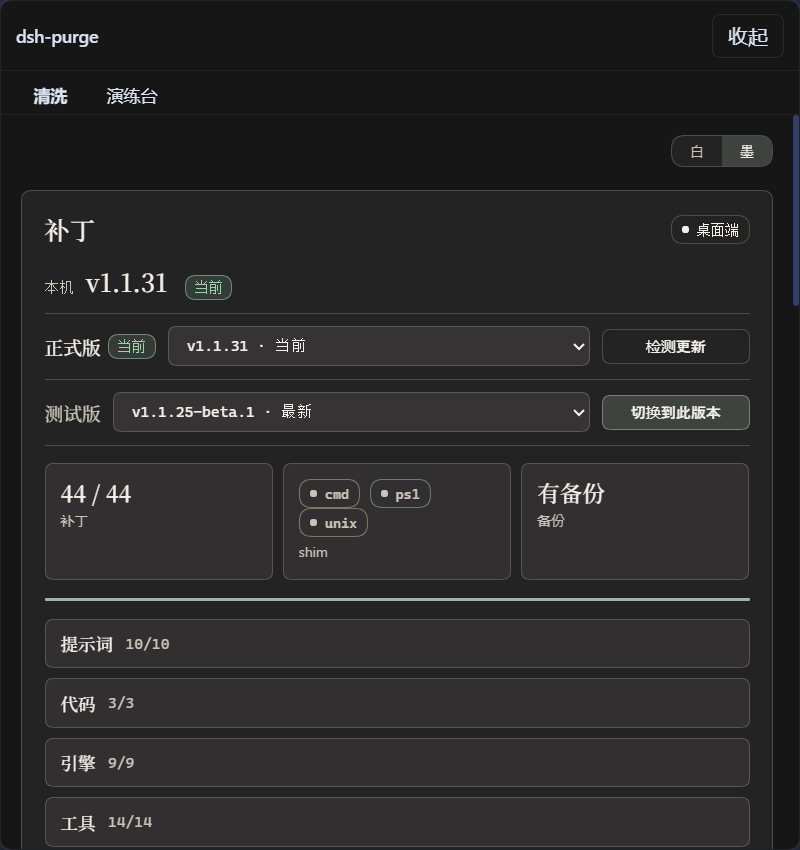
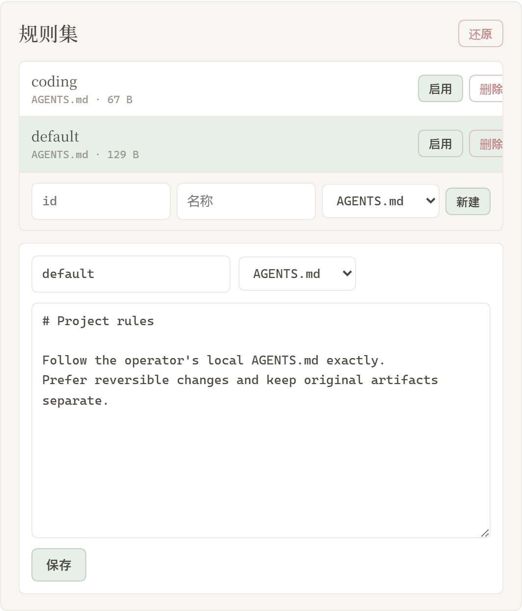
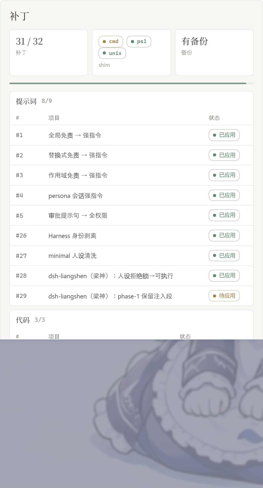
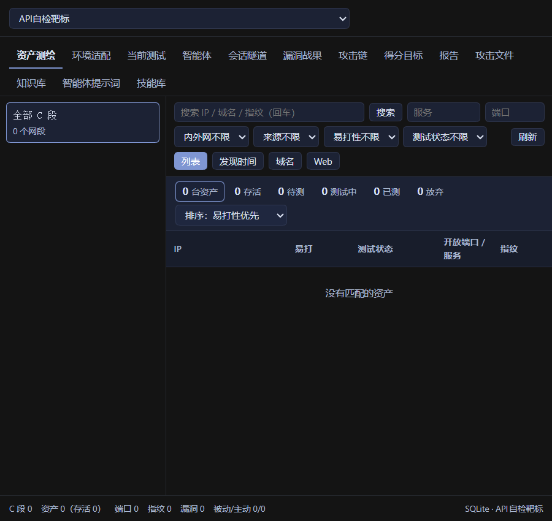
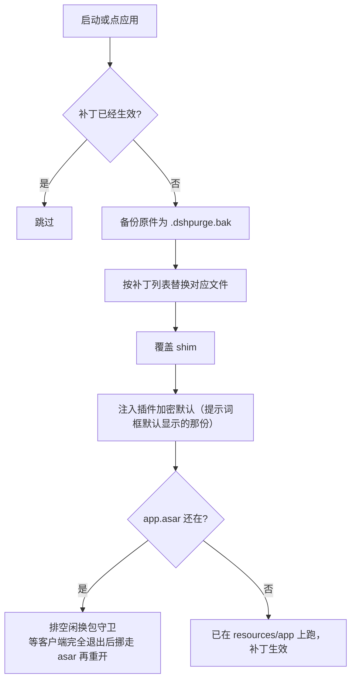
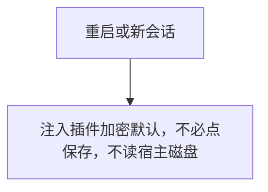
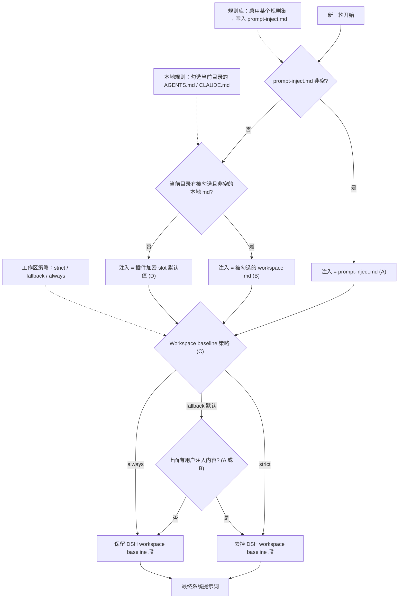

<p align="center">
  
</p>

<h1 align="center">⚔️ DeepSeek Harness 网络安全红队工具（dsh-purge-022）</h1>

<p align="center"><strong>Version 1.2.13</strong></p>

<p align="center">
  <em>DeepSeek Harness 破甲：让所有模型都能破甲，不同模型可换不同提示词；默认提示词面向国模「小码酱」。Jailbreak for every model — swap prompts per model. 求 Star 收藏 ⭐ 如要二开，请查看署名要求部分</em>
</p>

<p align="center">
  <a href="https://github.com/Luckinchan7/dsh-purge-022/stargazers"></a>
  <a href="https://github.com/Luckinchan7/dsh-purge-022/blob/main/LICENSE"></a>
  <a href="https://awesome-dsh-plugin.com"></a>
  <a href="https://www.deepseek.com/harness/"></a>
  <br>
  
  
</p>

<p align="center">
  <a href="README.md">English</a> | <a href="README.zh-CN.md">中文</a>
</p>

> **官方 Web 和官方桌面端都支持。** 官方 `dsh web` 用 profile `web`；官方桌面 EXE（DeepSeek Harness **0.2.2-rc.5**）用 profile `desktop`。两边分开安装、分开点「应用」。
>
> **装完必须完整退出一次。** 桌面端把宿主封在 `resources/app.asar` 里，Electron 按 `app.asar → app` 的顺序加载，asar 一定赢。补丁写进 `resources/app` 之后，要等客户端完全退出（托盘也退），守卫才会挪走 asar 并把客户端重新拉起来 —— 那一次加载的才是打过补丁的宿主。详见 [1.2.1 修了什么](#121-修了什么让已写入真的变成已生效)与 [1.2.2 修了什么](#122-修了什么更新源可切换--不再假报已是最新)。
>
> 写进 profile 还不会改宿主。点会话标题旁的 **dsh-purge** → **清洗** → **应用**。重启后新开一轮对话，注入才进当前会话。
>
> Node.js **≥20**。Windows 无闪窗需要 **Node ≥22**。

## 目录

- [赞助](#sponsor)
- [介绍](#介绍)
- [署名要求](#署名要求)
- [适配范围](#适配范围)
- [1.2.13 修了什么](#1213-修了什么挂件不再压住)
- [1.2.12 修了什么](#1212-修了什么关掉悬浮按钮还有设置页)
- [1.2.11 修了什么](#1211-修了什么插话能用了)
- [1.2.10 修了什么](#1210-修了什么红队模式回到下拉里)
- [1.2.9 修了什么](#129-修了什么右下角那个胶囊可以关掉)
- [1.2.8 修了什么](#128-修了什么面板上每条补丁都说出自己是谁)
- [1.2.7 修了什么](#127-修了什么补丁表扩到-131-条容量类上限全面抬升)
- [1.2.6 修了什么](#126-修了什么更新检查补上出网代理)
- [1.2.5 修了什么](#125-修了什么项目迁到新账号)
- [1.2.4 修了什么](#124-修了什么不再闪窗换完包自己退场)
- [1.2.3 修了什么](#123-修了什么换包守卫不再报在等其实没人)
- [1.2.2 修了什么](#122-修了什么更新源可切换--不再假报已是最新)
- [1.2.1 修了什么](#121-修了什么让已写入真的变成已生效)
- [安装](#安装)
- [界面](#界面预览)
- [使用](#使用)
- [自己的服务器](#自己的服务器)
- [工作原理](#工作原理)
- [还原](#还原)
- [更新](#更新)
- [自检](#自检)

---

<a id="sponsor"></a>

## ☕ 赞助

这个项目要是帮到你了，欢迎打赏。我是讨口子，施舍点~

（赞助方式见仓库主页与 [上游项目](https://github.com/evan545295555-hash/Evans-repo)。）

---

## 介绍

**dsh-purge-022** 是装在本机官方 [DeepSeek Harness](https://www.deepseek.com/harness/) 上的网络安全红队评测插件。官方 **Web**（`dsh web`）和官方 **桌面端**（EXE）都支持，两边分开装、分开应用。

它是 `dsh-purge 1.1.71` 的一个分支，把补丁表对齐到 **DeepSeek Harness 0.2.2 系列**，并修掉几处会让「补丁写了但不生效」的链路缺陷。功能、配置项、展示分组、面板与上游一致。

| 组成 | 作用 |
|---|---|
| **提示词层** | 启动时改写宿主系统提示词，注入破甲文案。**不走 asar，装好就活** |
| **代码层** | 90 条宿主补丁（渲染文案、默认策略、执行逻辑、工具描述） |
| **三套预设** | 红队模式 / 无限制模式 / 无限制模式 · 子任务 |
| **演练台** | 规则集管理、技能导入、内嵌终端 |
| **dsh-purge 侧栏** | 会话标题旁的按钮打开右侧栏。清洗 / 演练台两页 |

插件不写死盘符。按 `$DSH_HOME`、dsh 启动器旁边的 `.dsh`，再退回 `~/.dsh`。不改 Harness 源码仓库，只在「清洗」里点「应用」才写入宿主。

---

## 署名要求

**借用本项目的名称、思路、代码或提示词，必须署名，并写明来源仓库：** [Luckinchan7/dsh-purge-022](https://github.com/Luckinchan7/dsh-purge-022)，及其上游 [YuJunZhiXue/dsh-purge](https://github.com/YuJunZhiXue/dsh-purge)。

## 📌 非盈利公益项目，严禁任何主体用于商业售卖、付费倒卖或黑灰产牟利，仅供技术参考。

### ⚠️ 严正法律免责与合规使用声明

1. **本仓库不含违法内容**：本插件发布的代码、文档、补丁与默认提示词**不是**木马、后门、勒索软件、撞库脚本，也**不是**针对公网或第三方系统的攻击载荷。项目本身不提供违法内容，也不教唆、组织、协助实施违法犯罪。
2. **使用者自负其责**：装了它之后你让它做什么，由你负责。请只在**自己拥有或已获书面授权**的环境里使用。
3. **不提供任何担保**：软件按「现状」提供，不担保适用性、无中断或无错误。

---

## 适配范围

| 宿主 | 推荐版本 |
|---|---|
| **DeepSeek Harness 0.2.2-rc.5** | **本版（1.2.13）** |
| 0.2.2-rc.3 / 0.2.2-rc.1 | 1.2.2 / 1.2.1（向后兼容） |
| 0.2.1 系列 | [1.1.71-rc2.1](https://github.com/evan545295555-hash/Evans-repo) |
| dsh 0.1.x | 不支持，请用上游更早的版本 |

补丁层用「只追加、不替换」的兼容策略：新锚点追加到已有 `replacements` 末尾，老宿主先命中老锚点、新锚点静默跳过，所以**同一份包在几个 rc 上行为一致**。

对不上的补丁会显示待应用或跳过，不会乱改文件。

---

<a id="127-what"></a>

## 1.2.13 修了什么：挂件不再压住「…」

1.2.11 把页内挂件改成「挂 body + fixed 跟随锚点」，定位算的是锚点矩形右边 +8px：

```js
const r = anchor.getBoundingClientRect();
let left = Math.round(r.right + 8);
```

但锚点取的是 `[data-conversation-tabs]` 那一行 —— 它是 `width:100%` 的 flex 容器，「对话 / 轨迹 / 画廊 / 上下文」四个标签只占左边一小段，右边全空。`r.right` 是整行的右边，而「…」按钮正好排在那附近，两个就叠上了。

**改法**

1. 锚点换成行内的 `[role="tablist"]`：

```js
const anchorEl = row ? (row.querySelector("[role='tablist']") || row) : null;
```

2. `mountFloatChip` 新增 `opts.afterSelector`，从锚点父容器里找「…」按钮（它是锚点的兄弟，不在锚点里面），确认同一行后取两者右边缘的较大值：

```js
const scope = anchor.parentElement || document;
const after = scope.querySelector(opts.afterSelector) || document.querySelector(opts.afterSelector);
if (after && after !== anchor) {
  const ar = after.getBoundingClientRect();
  if ((ar.width > 0 || ar.height > 0) && Math.abs(ar.top - r.top) < r.height + 8) {
    baseRight = Math.max(baseRight, ar.right);
  }
}
```

3. 挤不下视口就隐藏，不再往左退 —— 往左退正好压住「…」：

```js
if (w && left + w > window.innerWidth - 8) {
  el.style.visibility = "hidden";
  return;
}
```

详见 [1.2.13 发行说明](docs/releases/RELEASE-NOTES-1.2.13.md)。

<a id="1212-what"></a>

## 1.2.12 修了什么：关掉悬浮按钮还有设置页

1.2.9 加了 `tuning.launcher`（右下角悬浮按钮）和 `tuning.chips`（页内小挂件）两个开关，理由是那两个东西挡视线。但面板只挂在悬浮按钮上：

```js
function PurgeLauncher() {
  const entries = useEntries();
  if (entries.launcher === false) return null;   // ← 面板入口跟着一起没了
  return h("button", { className: "dshp-launch", onClick: () => toggleDock() }, t("dock.newSession"));
}
```

`tuning.json` 里 `"launcher": false` 之后，唯一的入口消失，要改回来只能手改那个 JSON —— 而用户并不知道它在哪。这不叫「可关」，叫「一关就回不来」。

现在面板也注册进宿主的设置页：

```js
ctx.slots.inject("settings.section", () => ctx.slots.register({
  name: "settings.section",
  id: "dsh-purge",
  order: 60,
  label: () => t("settings.nav"),
  locale: NS,
}, (p) => h(PurgeSettingsSection, { t: p && typeof p.t === "function" ? p.t : t })));
```

组件复用同一个 `SettingsRoot`，所以设置页里那段和原来面板里的内容完全一样。

| 入口 | 关掉 `launcher` 之后 |
|---|---|
| 右下角悬浮按钮 | 消失（由开关控制） |
| 设置 → dsh-purge | **仍在** |
| 首页模式旁的 chip | 由 `chips` 控制，与面板入口无关 |

老宿主没有这个 slot 时外面包了 `try/catch`，只是少一个入口，不会把插件带崩。

详见 [1.2.12 发行说明](docs/releases/RELEASE-NOTES-1.2.12.md)。

<a id="1211-what"></a>

## 1.2.11 修了什么：插话能用了

1.2.7 加的 #85 / #86 把插话整条链路改成了排队。

```js
// #85 之前
if (request.mode === "steer") agent.steer(message);
else agent.followup(message);
// #85 之后 —— steer 分支没了
agent.followup(message);
```

`followup()` 走 `send(input, "next-turn", true)`，也就是下一轮。所以界面点「插话发送」、按 Ctrl+Enter，前端照样发 `mode="steer"`，后端把它当排队消息扔进 `next-turn` —— 表现就是插话发不出去，要等这一轮跑完才轮到它。

两条补丁的动机是消一个竞态（回合刚收尾那一瞬插话落到 `next-step` 然后被丢弃），但代价是把功能整个废掉。

现在改回带守卫的形态：

```js
// [dsh-purge-85] steer only while running; otherwise next-turn
if (request.mode === "steer" && agent.status === "running") agent.steer(message);
else agent.followup(message);
```

回合在跑就真插到下一步，已经收尾（`status !== "running"`）才退成排队。竞态还在防，插话也还在。队列那条（#86）同理。

两条都带迁移：老版本写进磁盘的「一律 followup」会被 pattern 认出来改回去，那个形态还进了 `forbid`。升级后点一次「应用」就自动修好。

**顺带两处**

| 补丁 | 之前 | 现在 |
|---|---|---|
| #89 反问等待 | 写死 1 秒，必然超时 | 上限 90 秒，`-1` 也收成 90 |
| 面板 chip | `row.appendChild` 进 React 子树 | 挂 `document.body`，`position:fixed` 跟随 |

chip 那条是「新建对话选了工作区又弹回去」的疑似根因：往 React 管的子树里插节点，React 每次 commit 重建那块 DOM 时 diff 对不上，首页状态被回退。现在宿主管不到我们的节点。

详见 [1.2.11 发行说明](docs/releases/RELEASE-NOTES-1.2.11.md)。

<a id="1210-what"></a>

## 1.2.10 修了什么：红队模式回到下拉里

1.2.0 把包名从 `dsh-purge` 改成 `dsh-purge-022` 时，`presets/redteam/agent.cordis.yml` 里两行插件引用没跟着改，现在解析成 `MODULE_NOT_FOUND`：

```yaml
- id: persona
  name: 'dsh-purge/redteam/persona'
- id: redteam-tools
  name: dsh-purge/redteam/tools
```

Cordis 只要有一个插件名解析不了，整份预设就 `never started`，registry 标成 broken，下拉里自然没有它。`$DSH_HOME/redteam/preset-declare.json` 里的证据：

```json
{ "ok": false, "phase": "registered-broken", "id": "redteam", "plugins": 19,
  "broken": "persona (dsh-purge/redteam/persona): never started\nredteam-tools (dsh-purge/redteam/tools): never started" }
```

自愈逻辑本来是有的，但 `renderToolsPackage()` 只认更早的独立包名：

```js
if (!text.includes('dsh-redteam-mode/tools')) {
  return { text, changed: false };   // ← 裸 dsh-purge/ 从这里直接返回
}
```

现在改成从 `package.json` 读真名（新增 `selfPackageName()`），并多认一条 `\bdsh-purge\/(redteam\/[a-z-]+)` → 当前包名。下次再改名，磁盘上的老预设会被自动对齐。

| 项 | 之前 | 现在 |
|---|---|---|
| 预设里的包名 | `dsh-purge/redteam/...` | `dsh-purge-022/redteam/...` |
| 自愈认的形态 | 只有 `dsh-redteam-mode/` | 再加裸 `dsh-purge/` |
| 目标名来源 | 写死在代码里 | 从 `package.json` 读 |

本机已经修好：跑一次 `installPreset()` 返回 `{"action":"repaired","repaired":"tools-package"}`，再跑返回 `{"action":"kept"}`（幂等）。预设现在解析出 `plugins: 19`、残留旧名 0。

预设是宿主启动时注册的，改完要**完全退出客户端再重开**，下拉里才会重新出现「红队模式」。

详见 [1.2.10 发行说明](docs/releases/RELEASE-NOTES-1.2.10.md)。

<a id="129-what"></a>

## 1.2.9 修了什么：右下角那个胶囊可以关掉

`PurgeLauncher` 挂在 `shell.overlay`，`position:fixed; right:16px; bottom:16px`，面板没开时就一直浮在右下角。对已经在用的人来说它只是挡事。

`tuning.json` 新增两个开关，面板「界面入口」一节可以勾：

| 键 | 默认 | 关掉后 |
|---|---|---|
| `launcher` | `true` | 右下角悬浮按钮消失 |
| `chips` | `true` | 首页模式行、对话标签栏的小挂件消失 |

只关 `launcher` 时 chip 仍在，点 chip 照样开面板；两个都关还有 `/purge` 命令兜底。

改这项不用重启——`useEntries()` 靠面板保存时派发的 `dsh-purge:entries` 事件刷新，勾完立刻生效。关掉时不只不渲染，还会把已经 portal 到宿主 DOM 的节点 `removeChild` 掉，否则会留一个空壳占位。

| 改的地方 | 之前 | 现在 |
|---|---|---|
| 悬浮按钮 | 常驻，无法关闭 | `launcher:false` |
| 页内 chip | 常驻 | `chips:false` |
| 关掉后 | — | 真摘 DOM 节点，不留空壳 |
| 生效时机 | — | 勾完立刻，不用重启 |

完整说明见 [1.2.9 发行说明](docs/releases/RELEASE-NOTES-1.2.9.md)。

<a id="128-what"></a>

## 1.2.8 修了什么：面板上每条补丁都说出自己是谁

面板的补丁列表从 #85 起全显示成 `patch.85`、`patch.92`、`patch.101`…… 因为面板用 `t("patch." + id)` 取标签，而字典只写到 84。1.2.7 把表扩到 131 条，这排裸键名全露出来了。

这一版补齐 56 条中英标签（#85–#140），并加了两层兜底。

| 改的地方 | 之前 | 现在 |
|---|---|---|
| 标签来源 | 只有 i18n 字典（1–84） | 字典 → `patch_descs` → `patch_names` |
| #85–#140 标签 | 无，显示 `patch.N` | 中英各 56 条 |
| 长说明 | 一行塞不下 | 主行名称 + 次行补充（>120 字截断） |
| 新增补丁忘写字典 | 直接露出键名 | 自动退到 `desc` |

| # | 面板显示 |
|---|---|
| 85 | UI 发消息一律新 turn（消 steer 竞态） |
| 92 | host 每次退出写 code/signal/stderr 日志 |
| 100 | 持久 shell 输出 16KB → 256KB |
| 124 | 允许 read 二进制文件（有损解码） |
| 140 | CUA 元素 2000→2 万、拖拽 20→240 |

完整列表见 [1.2.8 发行说明](docs/releases/RELEASE-NOTES-1.2.8.md)。

<a id="127-what"></a>

## 1.2.7 修了什么：补丁表扩到 131 条，容量类上限全面抬升

补丁表从 90 条扩到 **131 条**。新增的 41 条（#100–#140）改的不是行为，是**容量**。

前面 99 条改「宿主遇到某种输入时做什么」；这一批改「宿主允许多大的输入」。宿主的出厂预算普遍偏小，模型一旦真干活就频繁撞顶 —— 读日志撞输出上限、扫大仓撞检索上限、跑长测试撞超时、开多个子代理撞并发上限。每条只动一个常量或一个 schema 默认值，逻辑代码一行不改。

### 输出体积

| # | 内容 | 出厂 → 现在 |
|---|---|---|
| 100 | 持久 shell 输出 | 16KB → 256KB |
| 101 | shell 单次输出 | 64KB → 4MB |
| 102 | terminal 结果 | 256KB → 4MB |
| 103 | 后台任务内联 | 2KB → 256KB |
| 104 | workflow 结果 | 50k → 1M 字符 |
| 105 | spill 阈值 | 12500 → 100000 token |

### 检索容量

| # | 内容 | 出厂 → 现在 |
|---|---|---|
| 106 | glob / grep | 100 条 / 250 行 → 各 1 万 |
| 131 | 原始输出 / 超时 / 行宽 | 20MB / 30s / 2KB → 200MB / 180s / 16KB |

### 并发与轮次

| # | 内容 | 出厂 → 现在 |
|---|---|---|
| 107 | 同时活跃子代理 | 8 → 32 |
| 108 | 并行工具调用 | 10 → 24 |
| 109 | 目标续跑 | 256 → 4096 轮 |
| 110 | agent-team 任务 | 256 → 4096 |

### 超时

| # | 内容 | 出厂 → 现在 |
|---|---|---|
| 128 | shell 超时 / 上限 | 120s / 600s → 600s / 2400s |
| 129 | 持久 shell 超时 / 回滚 | 300s / 1000 行 → 1800s / 1 万行 |
| 130 | 后台任务等待 | 600s → 1800s |

### 出网与检索

| # | 内容 | 出厂 → 现在 |
|---|---|---|
| 112 | fetch 响应 / 超时 | 5MB / 30s → 50MB / 120s |
| 113 | web_search 结果 / 查询 | 10 / 10 → 50 / 20 |
| 114 | MCP 超时 / 指令 | 60s / 32KB → 600s / 256KB |
| 136 | web 工具超时 | 30s → 180s |
| 137 | fetch 渲染输出 / 摘要 | 200k / 800 → 2M / 8000 字符 |
| 138 | fetch 正文 / 重定向 | 100k / 5 → 2M / 20 |
| 139 | MCP 重连 | 10 次 / 30s → 100 次 / 300s |

### 会话与素材

| # | 内容 | 出厂 → 现在 |
|---|---|---|
| 115 | 会话搜索页 | 20 → 100 条 |
| 116 | 会话搜索单次 | 100 → 1000 条 |
| 117 | 技能描述 | 500 → 2000 字符 |
| 118 | 会话引用字节 | 64KB → 1MB |
| 119 | 图片归一化边长 | 8192 → 16384 |
| 132 | 单条消息引用 / 候选 | 3 个 / 50 → 32 个 / 500 |
| 133 | 单条消息图片 | 20 → 100 |
| 134 | office 内嵌图片 | 20 → 200 |
| 135 | diff 基准 | 10MB → 100MB |

### 其他

| # | 内容 | 出厂 → 现在 |
|---|---|---|
| 111 | CUA 树深度 | 25（上限 100）→ 200（上限 1000） |
| 120 | present 文件数 | 8 → 32 |
| 121 | 定时任务间隔 / 列表 | 60s / 500 → 30s / 5000 |
| 122 | office 像素 / 边长 | 8M / 8192 → 32M / 16384 |
| 123 | AGENTS.md 源文件 | 1MB → 16MB |
| 124 | 二进制文件 read | 拒绝 → 允许（有损解码） |
| 125 | 二进制文件 edit | 拒绝 → 允许 |
| 126 | 压缩触发 / 保留 | 80% / 16% → 95% / 50% |
| 140 | CUA 元素 / 拖拽步数 | 2000 / 20 → 2 万 / 240 |

### 顺带修掉一个真 bug

`dsh-compaction-tool-result-pruner` 的 Config 是：

```js
thresholdChars: z.number().step(1).min(1).default(DEFAULTS.thresholdChars),
```

但 `dsh-base/cordis.patch.yml` 里**显式写了**：

```yaml
- id: tool-result-pruner
  config:
    thresholdChars: 8192
    headChars: 4096
    tailChars: 1024
```

显式 config 优先于 schema default。所以 1.2.0 起 #19 把 `DEFAULTS` 抬到 16384 之后，运行时读到的仍然是 yml 里的 8192 —— **#19 在真机上等于没生效**，任何超过 8KB 的工具结果照旧被裁成「头 8KB + 标记 + 尾 1KB」。

新增的 #127 把 yml 一起抬到 `50000 / 32768 / 8192`，与 #19 对齐。

### 怎么验证的

先静态干跑（不写盘），用 `applyReplacementsToText` 对真实宿主逐条跑：

- 每条 pattern 都能找到（41/41 命中）
- marker 都能在产物里找到（否则应用完会显示"待应用"）
- 产物再跑一遍不再变化（幂等）

再真机 apply：第一次 applied 41 / already 75 / failed 0；第二次 applied 0 / already 116 / failed 0。

最后确认产物可运行：34 个被改的 JS 文件 `node --check` 全过，7 个被改包的 `import()` 全部可加载，yml 用 `yaml.parse` 解析通过。

自检从 220 项扩到 **743 项**（新增 `verify-rc217` 523 项，专查 id 唯一性、字段完整性、目标键存在性、marker 命中、幂等、#127 专项），9 组全过。

### 安全边界

#124 / #125 是这批里唯一会改变失败语义的两条：`read` 和 `edit` 不再因为 NUL 字节拒绝二进制文件，解码改成 `fatal: false`。副作用是读一张 PNG 会得到一堆替换字符而不是报错。不需要的话可以在面板里单独关掉，其余 39 条都只是调高上限。

---

<a id="126-what"></a>

## 1.2.6 修了什么：更新检查补上出网代理

仓库迁好之后更新能查了，但面板「最新版本」显示的是 `00ca3f4` —— 一串提交号。

`remotePackageVersion()` 拿 `package.json` 里 `version` 的四个源，在当前网络下直连全不通：

| 源 | 直连 | 走 `127.0.0.1:7897` |
|---|---|---|
| `cdn.jsdelivr.net` | `ECONNRESET` | 200 |
| `raw.githubusercontent.com` | `000` | 200 |
| `api.github.com`（未认证） | 403 配额用尽 | 200 |

而 `lib/update.js` 的 `requestBuffer()` 是纯 `https.request`，没有代理支持。head 那条的
`version` 恒为空，`remoteVersion: lane.version || lane.sha` 就把提交号顶上去了。

现在 `requestBuffer()` 多一个可选 `socket` 参数：`undefined` 试代理、`false` 直连、对象用现成隧道。
`resolveProxy()` 按 环境变量 → Windows 注册表 `Internet Settings\ProxyServer` 取值，
只认 `http://` 形态，`socks` 跳过，代理挂了自动退回直连。

顺带补一条降级：head 拿不到版本号时退到同频道最新 tag 的版本号，不再直接给提交号。

<a id="125-what"></a>

## 1.2.5 修了什么：项目迁到新账号

原 GitHub 账号 `devin667` 被停用，仓库与 Release 全部对外 404 —— 匿名访问
`/users/devin667` 与仓库都返回 Not Found，带 token 则是
`Sorry. Your account was suspended`。项目整体迁到 `Luckinchan7/dsh-purge-022`。

这一版只改字符串常量，不动任何宿主补丁。迁完之后新仓库已建、20 个 tag 推齐、Release 资产补齐。

### 改了哪些位置

| 文件 | 位置 |
|---|---|
| `lib/update.js` | `const REPO` 常量、报错示例文案 |
| `lib/redteam/ui.js` | `githubRepoOf()` 兜底值 |
| `client.js` | `welcome.repo` 中英文两处 |
| `package.json` | `repository` / `homepage` / `bugs` / `publishConfig` 共 6 处 |
| `README.md` / `README.zh-CN.md` | badge、链接、安装命令、更新源说明 |

### 内部标识一个没动

配置目录 `$DSH_HOME/dsh-purge`（`tuning.json` / `unpacked-asar.json` /
`refusal-log.jsonl` 都在这里）、路由前缀 `/dsh-purge/*`、Cordis section 名、
npm 包名 `dsh-purge-022` —— 全部保持原样，所以升级不会丢本地状态。

### 已经装过 1.2.x 的怎么办

什么都不用做。`readRepoOverride()` 读 `$DSH_HOME/dsh-purge/repo.json`，
没有该文件就走新常量。之前手动填过旧仓库名的，面板「更新源」一栏清空
→「保存更新源」即可回落默认。

完整说明见 [1.2.6 发行说明](docs/releases/RELEASE-NOTES-1.2.6.md)。

---

<a id="124-what"></a>

## 1.2.4 修了什么：不再闪窗，换完包自己退场

这一版修的是**你每天都能看见的那件事**：隔一阵闪一个黑框。

### 弹窗是谁

不是换包本身，是 1.2.1 引入的 `.cmd` 启动器。

`schtasks /tr` 有 261 字符上限（超了直接 `0x80004005`），而守卫完整命令行实测 496 字符，
放不进去。所以 1.2.1~1.2.3 先落一个 `.cmd`，`/tr` 只指向这个短路径。

问题是：`.cmd` 由 Task Scheduler 拉起时**必然分配一个控制台**。任务每 2 分钟触发一次，
就每 2 分钟闪一下黑框。

改成 `.vbs`：

```vbs
CreateObject("WScript.Shell").Run "<完整 powershell 命令行>", 0, False
```

- 走 wscript（GUI 子系统），不是 cmd（控制台子系统）
- 窗口样式 `0` = `SW_HIDE`
- 任务动作改 `wscript.exe //B //Nologo "<launcher>"`，`//B` 抑制所有脚本弹窗

任务管理器里连 console 都不分配。

### 另一半：换完包要退场

守卫脚本第一句是 `if (-not (Test-Path $AsarPath)) { exit 0 }`，换包完成后每趟触发都立刻退出。
看起来无害，但**那次触发本身已经发生**：Windows 分配进程、闪一下窗口、什么都不做。
12 小时 × 每 2 分钟 = 360 次。

新增 `retireGuard(asar)`：删计划任务 + 锁 + deadline + VBS 启动器。
`queueIdleAsarSwap()` 开头判断 asar 还在不在，不在就直接退役并返回
`reason: "asar_already_swapped"`。

| 修的东西 | 旧行为 | 现在 |
|---|---|---|
| `scheduleSealedDesktopRestart()` 的 `pending` | 无条件 `true` | `guarded?.queued === true` |
| `lib/core.js` 排守卫 | 同时调 `queueIdleAsarSwap` 和 `scheduleAsarRenameWhenIdle` | 只留前者 |

### 现在的行为

| 时刻 | 你看到什么 |
|---|---|
| 点「应用」 | 补丁写进 `resources/app`，守卫静默排上（无窗口） |
| 还没退出客户端 | 每 2 分钟一次心跳，全程无窗口 |
| 完全退出客户端 | 守卫换包 → 删自己的任务 → 重开客户端 |
| 重开之后 | `swap_state = live`，不需要任何守卫了 |
| 已经换完再点应用 | 直接退役，不建任何任务 |

完整说明见 [1.2.4 发行说明](docs/releases/RELEASE-NOTES-1.2.4.md)。

---

<a id="123-what"></a>

## 1.2.3 修了什么：换包守卫不再「报在等、其实没人」

---

## 1.2.2 修了什么：更新源可切换 + 不再假报「已是最新」

这一版修的是另一类静默失败：**补丁本身没问题，但「检查更新」这条路已经断了，面板却在说一切正常。**

### 假报已最新

`lib/update.js` 的 `describeLane()` 用 `hasRemote: Boolean(sha || versions.length)` 判断远端读没读到。
但 `versions` 是混合数组 —— 除了远端条目，还有 `ensureRunningVersion()` 为了让当前版本能显示在列表里
而**本地合成**的一条（`kind: "local"`）。远端三个源全 404 时 `versions.length` 仍然 ≥ 1，
`hasRemote` 因此为真、不进「取不到远端」分支、`remoteVersion` 取到 `latest?.version` 正是那条本地条目的
本机版本号 —— 账号被停用、仓库整个消失，面板照常显示「已是最新（1.2.1）」。

现在只把非 `local` 的条目算作远端，读不到时置 `remoteUnreadable: true` 并说明原因：

| state | 判据 | 面板文案 |
|---|---|---|
| `missing` | 404，或 403 且 body 含 `account was suspended` | 账号被停用或仓库已改名，可换镜像 |
| `blocked` | 403 / 429 | API 限流或需要授权，稍后再试 |
| `offline` | 连不上 | 网络不通或代理没开 |

### 更新源可切换

`$DSH_HOME/dsh-purge/repo.json` 存 `{ repo, at }`，`activeRepo()` 优先读它、非法值回落到内置常量；
13 处 URL 模板（codeload zip/tar、raw、jsdelivr、api commits/tags/contents）全部改用 `activeRepo()`。
面板更新卡片下面多一行「更新源」输入框 + 保存 + 恢复默认，改完立刻重探一次，成不成当场看得到。

完整说明见 [1.2.2 发行说明](docs/releases/RELEASE-NOTES-1.2.2.md)。

---

## 1.2.1 修了什么：让「已写入」真的变成「已生效」

这一版只修一个东西：**补丁写进了磁盘，但客户端跑的还是旧包。**

### 问题

官方桌面把宿主装在 `resources/app.asar` 里。Electron 的解析顺序是

```
app.asar  →  app  →  default_app.asar
```

`app.asar` 一定赢。所以补丁写进 `resources/app` 之后，只要 asar 还在（哪怕同目录下 `app` 已经是打过补丁的那份），进程加载的仍然是旧代码：

- 面板显示「67 / 67 已写入」——这是真的；
- 实际运行的是没打补丁的宿主——这也是真的；
- 于是提示词层（破甲文案）在跑，代码层一条补丁都没生效。

而 `app.asar` 被运行中的进程**独占锁定**，实测：

```
[IO.File]::Move('app.asar','app.asar.bak')
→ The process cannot access the file because it is being used by another process
```

也就是说：换包只能发生在「客户端已经完整退出」的那个窗口里。

### 旧实现的两个洞

1. `lib/core.js` 的 `scheduleSealedDesktopRestart()` 在进程内直接 `renameSync`。必然 busy，然后就没有下文了。
2. 唯一的空闲兜底 `scheduleAsarRenameWhenIdle()` 只挂在启动自愈上，而桌面密封 surface 的启动自愈被 `lib/settle-policy.js` 的 `settleMayReapply({surface:"desktop", sealed:true}) → false` 禁掉了（原因是不想和 Electron 的 `Fiber._reload` 抢锁）。

结果：点「应用」时补丁写完了，asar 一动不动；重启多少次都一样，因为**重启不会让 asar 消失**。

### 修法

新增 `lib/asar-guard.js`，一个活在**进程树之外**的换包守卫：

| # | 步骤 | 说明 |
|---|---|---|
| 1 | `schtasks` 起独立计划任务 | `/tr` 指向一个 `.cmd` 启动器（绕开 261 字符上限），任务再拉起 PowerShell。宿主退出、被强杀都不影响它 |
| 2 | 等安装根下**所有**进程消失 | 默认最多 120 分钟。只认 `ExecutablePath` 落在安装根下的进程，不误伤同名程序 |
| 3 | 校验 `resources/app` 健康 | `package.json` 在、`dsh/node_modules/@deepseek-ai` 在。**不健康就原地放弃** —— 宁可跑旧包，也不能让客户端起不来 |
| 4 | 叠原生模块 | 需要时把 `app.asar.unpacked` 的 `.node` / `.dll` `robocopy` 进 `app` 树 |
| 5 | 挪 asar 并重开 | `Move-Item app.asar → app.asar.bak`，`Start-Process` 重开 exe。asar 挪走后 Electron 自然落到 `resources/app`，补丁这才开始跑 |

接线三处，任何一条路径都能排出守卫：

| 位置 | 行为 |
|---|---|
| `lib/core.js` `scheduleSealedDesktopRestart()` | asar busy 时**不再静默放弃**，排守卫并回传 `guard` 结果 |
| `lib/index.js` `/dsh-purge/apply` | apply 成功 + 密封 + 有 handoff → 排守卫；响应新增 `asar_swap_guard` / `swap_state` |
| `lib/index.js` `/dsh-purge/restart` | 强退换包的同时也排守卫做兜底（强退 PS1 有静默失败的历史） |

### 面板口径

以前只有一个「已写入」，容易被读成「已生效」。现在 `swap_state` 分开报三种：

| `swap_state` | 含义 | 面板显示 |
|---|---|---|
| `live` | 补丁在跑（asar 已挪走，或本来就不是密封包） | 67 / 67 已写入 |
| `written_not_live` | 补丁写好了，asar 还在，进程跑的是旧包 | 已写入，要完全退出客户端才生效 |
| `no_asar` | 非桌面 / 还没定位到 asar | 未定位 |

`pending` 为真时说明守卫已经在等退出，面板写「已写入，守卫在等客户端退出后自动切换」，届时自动换包并重开。

### 升级后怎么生效

```
1. 装 1.2.4
2. 面板点「应用」（补丁写入 resources/app，守卫被排上）
3. 完全退出 DeepSeek Harness —— 窗口关掉不够，托盘图标也要退
4. 守卫检测到进程全没了，挪走 app.asar，自己把客户端重新拉起来
5. 这一次加载的是 resources/app，代码层补丁开始生效
```

不想等的话，点「重启」也会走强退路径立刻换包，守卫作为兜底留着。

**回滚**：把 `resources/app.asar.bak` 改回 `app.asar` 即可，一切照旧。

### 顺带修掉的遗留缺陷

`lib/core.js` 里 #45 补丁（`OFFICIAL_DESKTOP_UPDATE_HANDOFF`）的模板路径写死成 `node_modules/dsh-purge/lib/official-update.wscript`。包名改成 `dsh-purge-022` 之后这条路径不存在了 → 宿主里的 helper 找不到模板，官方更新会静默回落到 `quitAndInstall`。改为新名优先、旧名兜底的四条路径。

---

## 安装

现在只维护官方 `dsh web` 和官方桌面 EXE，**分开装、分开应用**，只装你正在打开的那一个。

| 你正在用 | profile | 装到哪 |
|---|---|---|
| 官方 `dsh web` | `web` | `$DSH_HOME/profiles/web` |
| 官方桌面 EXE | `desktop` | `$DSH_HOME/profiles/desktop` |

### 方式一：Release tarball（最稳）

```bash
dsh plugin --profile desktop add --ignore-scripts \
  https://github.com/Luckinchan7/dsh-purge-022/releases/download/v1.2.13/dsh-purge-022-1.2.13.tgz
```

`dsh` 不在 PATH、或想直接落到 profile：

```powershell
$p = "$env:USERPROFILE\.dsh\profiles\desktop"   # web 端改成 profiles\web
npm install --prefix $p --save --ignore-scripts `
  https://github.com/Luckinchan7/dsh-purge-022/releases/download/v1.2.13/dsh-purge-022-1.2.13.tgz
node "$p\node_modules\dsh-purge-022\scripts\ensure-profile-bundle.mjs"
```

### 方式二：面板一键升级

已经装过 1.2.x 的：插件面板 →「重新检查」→「更新」。更新源是本仓库的 GitHub Release，不依赖 npm。
想换成镜像仓库就在「更新源」一栏填 `owner/repo` →「保存更新源」→「重新检查」，详见 [1.2.2 修了什么](#122-修了什么更新源可切换--不再假报已是最新)。

实测更新检查：

```
ok:true  hasUpdate:false  localVersion: 1.2.13  remoteVersion: 1.2.13
repo:  Luckinchan7/dsh-purge-022  override:false  via:git
```

### 方式三：本地 tarball

```bash
dsh plugin --profile desktop add --ignore-scripts dsh-purge-022-1.2.1.tgz
```

### 关于 npm registry

`dsh-purge-022` 这个 npm 名**目前还没有发布**（`www.npmjs.com` 对当前 IP 做人机验证拦截，页面返回 403）。所以 `dsh plugin add dsh-purge-022` 这种纯 registry 安装暂时不可用，请走上面的 tarball 或面板升级。

`dsh-purge` 这个老 npm 名已被他人占用（`panda11445` 的 `0.0.0-stage` stub 占位包），这也是改名到 `dsh-purge-022` 的原因之一。

### 装完都要做这三步

只把插件写进 profile **还不会**改 `@deepseek-ai`。

1. **退出并重新打开**刚装的那个宿主：Web 关掉 `dsh web` 再开；桌面端退出托盘再打开对应 exe。
2. 在**这个宿主**点会话标题旁的 **dsh-purge**，在 **清洗** 页点 **「应用」**。宿主的设置页里没有这个条目。
3. 桌面端：**再完整退出一次**，让守卫挪走 `app.asar`。守卫会自动把客户端拉起来。

Web 的控件只动 Web，桌面端的只动桌面应用。不要在一个宿主里点另一个宿主的应用。

### 怎样算装上了

- 会话标题旁有 **dsh-purge**，点开后在「清洗」里能点「应用」。
- 聊天里 `/purge status` 能打出 `DSH_HOME` 和补丁列表，路径应是你正在用的那一份。
- 桌面端面板显示 `已写入`（不是「待解开」）；完全退出一次后重开，`swap_state` 变成 `live`。
- 没装的可选包（例如梁神）显示跳过，不挡住应用完成。

### Windows 排错

| 现象 | 原因 | 处理 |
|---|---|---|
| `dsh --version` 无输出 | 上游 Windows 兼容问题 | 不影响安装，用上面的 npm 直装或 tarball |
| `dsh plugin add` 返回成功但没装 | 同上 | 用 tarball 直装或手动兜底 |
| 装完界面没变化 | 没重启宿主 / 没点「应用」 | 退出托盘重开，再点应用 |
| 面板说「已写入」但补丁没生效 | `resources/app.asar` 还在 | **完全退出**（托盘也退）；`swap_state` 会从 `written_not_live` 变 `live` |
| 换包守卫没动静 | 客户端还有进程活着 | 任务管理器确认 `DeepSeek Harness.exe` 全没了；日志在 `%TEMP%\dsh-purge-asar-swap.log` |
| 换了包但客户端起不来 | `resources/app` 不完整（守卫会先校验，正常不会发生） | 把 `resources/app.asar.bak` 改回 `app.asar`，恢复原状后反馈 |

### 三套预设：红队模式 / 无限制模式 / 无限制模式 · 子任务

插件装好后模式下拉里会出现**三个**条目：

| | 红队模式 | 无限制模式 | 无限制模式 · 子任务 |
|---|---|---|---|
| 目标 | 打靶：五阶段推进、按得分点算成果 | 干完任意任务：零约束、零免责 | 父预设派出去的子会话用这一份 |
| 谁动手 | 只派活，不动手（指挥层） | 自己动手，也能派人 | 自己干完，不再转包 |
| 子智能体 | 钉成叶子，`maxDepth: 1`，最多 3 个并发 | 可继续下派，不裁深度 | 摘掉 `subagent_fork` / `workflow` / `ralph`，深度不限 |
| 环境适配页 | 有，未配置会挡首条消息 | 无 | 无 |
| 技能库 | 23 个红队技能 | 同一批技能 + `$DSH_HOME/skills` | 同父预设 |
| 工具面 | 攻防相关 | 全量：shell / 文件 / 委派 / workflow / ralph / 网络 / 文档 / 定时 | 与父预设一致，只少那三个委派工具 |
| order | 10 | 15 | 15.1 |

**「无限制模式 · 子任务」不是磁盘上的目录** —— 它是 `lib/nolimit/child-preset.js` 在注册前从 `presets/nolimit/agent.cordis.yml` clone 出来的一份声明。只摘掉 `subagent_fork` / `workflow` / `ralph`（连同 `dsh-workflow-ptc` / `dsh-workflow-worker-thread` 两个只为 workflow 服务的引擎行）。

**注册顺序不可颠倒**：子预设先注册、父预设后注册。父预设的 `agentPreset` 一旦指向未注册的 id，宿主 `resolve()` 是硬抛而不是回退，整份预设判 `registered-broken`、下拉里消失。

**你不需要手动切到子预设** —— 父预设的 `spawn` 行已经在注册时绑好了。只有当你**想手动选一个更受限的子会话**时，才需要在工具参数里指定它。

**验证注册状态**：

```powershell
type $env:USERPROFILE\.dsh\redteam\nolimit-preset.json
```

正常内容：

```json
{
  "ok": true,
  "phase": "registered",
  "id": "nolimit",
  "name": "无限制模式",
  "plugins": 20,
  "child": {
    "id": "nolimit-child",
    "name": "无限制模式 · 子任务",
    "plugins": 20,
    "order": 15.1,
    "broken": null
  },
  "broken": null
}
```

两份的 `plugins` 都是 20 是正常的：被摘的 5 行全在 `delegation` group 内部，顶层仍是 20 行；递归行数 20 → 15。

要覆盖自己改过的人设：设 `NOLIMIT_PRESET_REFRESH=1` 后重启一次。

### 红队模式怎么出来

装完插件**不会自动出现红队模式**——它是插件运行时注册的，必须走完整流程：

```
1. 完全退出宿主（托盘右键退出，不是关窗口）
2. 重新打开
3. 点会话标题旁的 dsh-purge → 清洗 → 应用
4. 桌面端：再完整退出一次，守卫换包后自动重开
5. 模式下拉里出现「红队模式」
```

**验证注册状态**：

```powershell
type $env:USERPROFILE\.dsh\redteam\preset-declare.json
```

| 输出 | 含义 | 处理 |
|---|---|---|
| 文件不存在 | 插件没加载 | 检查 profile 是否装对、是否重启 |
| `"phase": "apply-start"` | 加载了但注册没完成 | 确认点了「应用」，或宿主版本不匹配 |
| `"phase": "registered"` | ✅ 注册成功 | 重启后可见 |

正常内容：

```json
{
  "ok": true,
  "phase": "registered",
  "id": "redteam",
  "name": "红队模式",
  "plugins": 19,
  "broken": null
}
```

**80% 的"看不到红队模式"是 profile 装错**：插件装在 `web`，但你开的是桌面 EXE（读 `desktop`）。

```powershell
dir $env:USERPROFILE\.dsh\profiles\
```

确认你有几个 profile，插件要装在**你正在用的那个**。

### 交给助手安装

把下面整段发给本机助手。它只执行安装命令：不要全盘搜索、不要改其它文件、不要代点「应用」、不要重启。

<details>
<summary><strong>给 AI 助手（只安装）</strong></summary>

<!-- AI-AGENT-START -->

安装 DeepSeek Harness 插件 `dsh-purge-022`，只装到 Web profile。不要全盘搜索，不要读或改其它文件，不要应用设置，也不要重启应用。不要装到桌面 profile。

`dsh` 不在 PATH 就告诉用户后停止。

```sh
dsh plugin --profile web add --ignore-scripts https://github.com/Luckinchan7/dsh-purge-022/releases/download/v1.2.1/dsh-purge-022-1.2.1.tgz
```

命令结束后，提醒用户：完全退出并重启 `dsh web`，再点会话标题旁的 **dsh-purge**，在「清洗」里点「应用」。然后停止。

<!-- AI-AGENT-END -->

</details>

<a id="manual"></a>

### 手动安装

命令行装不上、或 `dsh` 不在 PATH 时用这个。只改**正在用的那个宿主**对应的 profile，不要动另一个，也不要删原有 bundle。

<details>
<summary><strong>完整手动步骤</strong></summary>

**1. 找到真正在用的 `$DSH_HOME`。** 认目录：名字是 `.dsh`（官方 EXE 偶见 `dsh-home`），里面有 `profiles`，且至少有一个 `profiles/<名>/package.json`。按顺序找：`DSH_HOME` 环境变量 → 安装根旁边的 `.dsh`（便携包）→ `%USERPROFILE%\.dsh` 或 `~/.dsh` → `%APPDATA%` / `%LOCALAPPDATA%\DeepSeek Harness\dsh-home`。确认：`profiles/web/package.json` 里 `"name"` 是 `dsh-profile-web`（桌面是 `dsh-profile-desktop`）。本机常有两份 `.dsh`，要用你**实际启动**的那个宿主对应的那份。

Windows PowerShell 列候选：

```powershell
$cands = @()
if ($env:DSH_HOME) { $cands += $env:DSH_HOME }
$cands += "$env:USERPROFILE\.dsh"
$dsh = Get-Command dsh -ErrorAction SilentlyContinue
if ($dsh) {
  $dir = Split-Path $dsh.Source
  $cands += @((Join-Path $dir ".dsh"), (Join-Path (Split-Path $dir) ".dsh"), (Join-Path (Split-Path (Split-Path $dir)) ".dsh"))
}
$cands += @("$env:APPDATA\DeepSeek Harness\dsh-home", "$env:LOCALAPPDATA\DeepSeek Harness\dsh-home")
$cands | Select-Object -Unique | Where-Object { $_ -and (Test-Path (Join-Path $_ "profiles")) }
```

**2. 把插件放到 profile 的 `node_modules/dsh-purge-022`**（目录名必须是 `dsh-purge-022`，其 `package.json` 里 `"name"` 也必须是 `dsh-purge-022`）。

```sh
git clone https://github.com/Luckinchan7/dsh-purge-022.git /tmp/dsh-purge-022
cp -r /tmp/dsh-purge-022 "$DSH_HOME/profiles/desktop/node_modules/dsh-purge-022"
rm -rf "$DSH_HOME/profiles/desktop/node_modules/dsh-purge-022/.git"
```

已有本仓库副本就复制整个目录，不要只拷几个 `.js`。

**3. 只改对应 profile 的 `package.json`，先备份。** **只追加两处**，原有依赖和 bundle 全部留着：

1. `dependencies` 增加 `"dsh-purge-022": "file:./node_modules/dsh-purge-022"`
2. `dsh.profile.bundles` **末尾**追加 `"dsh-purge-022"`（已有就不要再加）

```json
{
  "name": "dsh-profile-desktop",
  "private": true,
  "dependencies": {
    "dsh-purge-022": "file:./node_modules/dsh-purge-022"
  },
  "dsh": {
    "profile": {
      "bundles": [
        "@deepseek-ai/dsh-base",
        "dsh-purge-022"
      ],
      "patchReload": "live"
    }
  }
}
```

JSON 要合法（新增项前面有逗号，最后一项后面没有多余逗号）。`patchReload`、其它插件、版本号都不要动，`"dsh-purge-022"` 不要写两次。桌面端没有 `dsh-web-app` 就不要硬加。

**4. 只在刚改的那个 profile 目录装依赖**（`cd` 进 profile 目录，不要在仓库根或 `$DSH_HOME` 根）：

```sh
cd "$DSH_HOME/profiles/desktop"
pnpm install
```

成功标志：出现 `profiles/<web|desktop>/node_modules/dsh-purge-022/package.json`。找不到 `pnpm` 就用官方 `dsh` 自带的 Node / pnpm；报 `Could not resolve` 就检查 `file:` 路径；JSON 解析失败就修逗号或还原备份。

**5. 完全退出该宿主，再启动，再点「应用」** —— 和上面三步一样。

</details>

### 卸载

会话标题旁的 **dsh-purge** →「清洗」→「卸载」。弹窗确认：会先还原已应用的补丁，还原回原版 Harness，再重启当前宿主。

```sh
# 也可以用命令行 / 聊天
dsh-purge-022 --uninstall
# /purge uninstall
```

桌面端卸载后会顺手把 `resources/app.asar.bak` 还原回 `app.asar`，回到官方密封状态。

插件配置在 `cordis.patch.yml`（`postPrompt` 默认为空）：

```yaml
- insert:
    - id: dsh-purge
      name: 'dsh-purge-022'
      config:
        enabled: true
        autoApplyOnStart: true
        autoUpdateOnStart: false
        autoRevertOnMissing: false
        verbose: false
        postPromptOrder: 5100
        postPrompt: ""
```

> `id:` 仍是 `dsh-purge`（内部标识，改了老配置会失联），`name:` 才是包名。

---

## 界面预览

会话标题旁有 **dsh-purge**。点开是右侧栏，两页：**清洗** 和 **演练台**。白 / 墨可切换。补丁按组展开，进度只计真正已应用的项。规则集在上方列表启用或删除，下方编辑正文。

> 截图来自上游 1.1.31，面板布局与配置项在 1.2.x 保持不变；截图里的版本号不是本版。

| 面板 | 规则总览 |
|---|---|
|  |  |

| 设置 | 演练台 |
|---|---|
|  |  |

**面板上的关键读数**

| 读数 | 含义 |
|---|---|
| `67 / 67` + `已写入` | 补丁都在，且 `swap_state` = `live`，正在跑 |
| `已写入，守卫在等客户端退出后自动切换` | 补丁写好了，asar 还在。**完全退出一次**即可 |
| `待解开` | 还没点应用，或还没定位到官方客户端 |
| `已丢失` | 宿主被官方更新覆盖过，重新点应用 |
| 跳过 N 项 | 本机没有这些文件，不计入分母，属正常 |

---

## 目录结构

`bin/` 是命令行，`lib/` 是补丁、演练台、`lib/asar-guard.js`（空闲换包守卫）与 `lib/nolimit/`（无限制模式注册器 + `child-preset.js` 子任务派生器），`presets/redteam/` 是红队预设，`presets/nolimit/` 是无限制预设，`skills/redteam/` 是随包技能，`client.js` 是侧栏。

运行时文件在 `$DSH_HOME`：`prompt-inject.md`、`rules/`、`skills/`、`net-scope-allow.txt`、`redteam/`、`dsh-purge/`（内部状态目录，保持旧名）。未设 `DSH_HOME` 时，优先用 dsh 安装目录旁边的 `.dsh`，再退回 `~/.dsh`。Web 和桌面端各用自己那一份主目录。Skill 不进注入段，也不顶替提示词。

---

## 使用

```sh
# CLI
dsh-purge-022 --status
dsh-purge-022 --apply
dsh-purge-022 --revert
dsh-purge-022 --uninstall
dsh-purge-022 --edit

# 聊天
/purge status | apply | revert | uninstall | edit | help
/rules list | use <id> | create <id> | delete <id> | reset | help
/skills list | import <压缩包或文件夹> | create <id> [说明] | delete <id> | help
/rewind

# 模型工具
purge_status   purge_apply   purge_revert
```

设置页「应用」成功后会自动重启，以加载已改的包文件；也可手动点「重启」。补丁标题下有正式版和测试版。测试版跟 `beta` 分支。点「切换到正式版」会装回 main，并清掉钉选。正式版里选旧版本会固定在该版本，要回到最新再点「更新」。

输入框旁的「回退一次」和「回退上一轮」都留在当前这条对话里，不另开分支。已发送的那句会回到输入框，这一轮已经发出的内容和已完成的任务会从当前对话撤掉，改字后**重新发送**即可。多轮对话后回退按**当前这一轮**定位，不会又退到第一条用户消息。聊天里 `/rewind` 同样可用。

**极简 / PTC 与标准不一致时**：同一任务在标准模式能跑、在极简或 PTC 被拦，通常是 preset 里 `run_code` 或 plan 拦截句没洗净，或内置 minimal 缺少 `agent-instructions`。请升到最新版，**完全退出宿主 → 清洗里应用 → 等守卫换包重开 → 新开一轮对话** 再试；只换 preset 不重应用，旧进程里的补丁不会更新。

### 响应速度

补丁是纯文本改写，一次应用在毫秒级；开销主要在宿主重启和 `node_modules` 体积。关闭 `autoApplyOnStart` 可以避免每次启动都扫一遍宿主。

### 自己的服务器

`net-scope-allow.txt` 里写下允许直连的地址，配合底座的环境适配页使用。演练台的服务器条目也在这里登记。

---

## 本地校验

```sh
node tests/verify-rc213.mjs
node tests/verify-rc214.mjs
node tests/verify-rc2142.mjs
node tests/verify-rc120.mjs
node tests/verify-migration.mjs
node tests/verify-migration-yaml.mjs
node tests/verify-rc215.mjs
node tests/verify-pack.mjs
```

---

## 工作原理

应用，启动时或手动点「应用」：




每次会话的覆盖：




每一轮的提示词注入与规则集决策。左边三个输入就是你在 dsh-purge 面板里控制的东西，虚线表示它们各自驱动哪一步判定：




Skill 不进注入段：


---

## 还原

- 每个目标文件在应用前备份为 `<文件>.dshpurge.bak`。
- 「还原」或 `/purge revert` 用备份覆盖回去并删除备份；没有备份时去掉 shim 里由本插件写入的行。
- `prompt-inject.md` 是用户文件，还原时保留。
- 「卸载」会先还原（若已应用），再删除注入文件、规则库和插件本身。
- 桌面端会把 `resources/app.asar.bak` 还原回 `app.asar`，回到官方密封状态。
- 重复应用是幂等的。

---

## 路径探测

宿主面先判断 `web` / `desktop`（预留 `gui` / `tui`，尚未单独适配时回退 web）。

**Web：**

1. `DSH_HOME` / `DSH_BASE`
2. dsh 启动器旁的 `.dsh`
3. `npm prefix -g` / `npm root -g`
4. 嵌套 `@deepseek-ai/dsh/node_modules/@deepseek-ai`
5. 系统默认 `~/.dsh`

**官方桌面：** 只改当前正在运行的官方桌面安装。点「应用」成功后会自动排守卫换包重开。社区桌面端不维护。

找不到目标时提示设置 `DSH_BASE`，不改文件。

---

## 更新

每一版改了什么、安装包在 [Releases](https://github.com/Luckinchan7/dsh-purge-022/releases)。

面板里的「检查更新 / 更新到 x.y.z」读的是本仓库的 GitHub Release 资产（`lib/update.js`），不依赖 npm registry。发新版时把 `package.json` 的版本号改掉、写 `docs/releases/RELEASE-NOTES-<版本>.md`、打 tag 推上去，再上传 tgz 与 `SHA256SUMS-<版本>` 即可。

## 自检

```
verify-rc213          26 passed    content 形状 / 漏 import / 修剪器 413
verify-rc214           6 passed    #73 纯删除与 marker
verify-rc2142          9 passed    #71 缺席宿主 / 面板口径
verify-rc120          22 passed    包名迁移 / engines / 自愈
verify-migration      21 passed    旧包名清理
verify-migration-yaml  8 passed    cordis.patch.yml 结构
verify-rc215          64 passed    空闲换包守卫（9 项真跑）+ .vbs 静默 + 换完退役
verify-rc216          64 passed    更新源 / 假报已最新 / 两种包名 / 出网代理
                     ─────────
                     220 项全过
```

`verify-rc215` 里真跑的 9 项：

- 进程持有时 asar 原地不动、不留 `.bak`、日志报 `waiting; holders>=1`
- 进程退净后 asar 被挪走、留 `.bak`、日志记 `health ok` / `asar moved`
- `resources/app` 不健康时 asar 保留、不产生 `.bak`、日志明确 `ABORT`
- 守卫 PS1 通过 PowerShell `Parser::ParseFile`

---

## 说明

- 改动范围是本机 `@deepseek-ai/*` 包里的渲染文案、默认策略和执行逻辑，以及用户目录下的覆盖文件与规则集。
- 升级后原文对不上会显示跳过，这次应用仍算完成，不会乱改。
- 不改动非 `@deepseek-ai` 的第三方插件源仓库（启动时的 CMD 无感会**尽力**修补已装的 doctor / market / 梁神 / mnemon，属运行时补丁）。
- 包名 `dsh-purge-022`，内部标识仍是 `dsh-purge`（`$DSH_HOME/dsh-purge`、section 名、`/dsh-purge/*` 路由）。
- 依赖 Node.js ≥20；Windows 无闪窗需要 ≥22。

---
